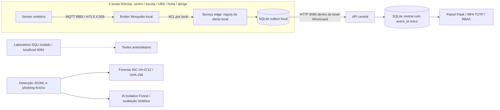

# E1 — Arquitetura atual do protótipo Vila Aurora

**Global Solution 2026.2 | Engenharia da Computação**
**Natureza:** protótipo acadêmico, com dados e identidades sintéticos.
**Data da verificação:** 18/11/2026.
**Estado:** implementação parcial dos RT-01 a RT-23, conforme `docs/MATRIZ_REQUISITOS_AUDITADA.md`.

## 1. Arquitetura realmente implementada

**Escopo comprovado:** cinco brokers MQTT e sensores, edge autônomo com SQLite, certificados individuais e revogação por CRL, WireGuard, painel Flask local com TOTP/RBAC, laboratório SQLi, simulação phishing, detecção offline, forense e IA sintética.

**Não representados como implementados:** PostgreSQL, SIEM/Wazuh centralizado, domínio DNS real, Wazuh implantado e coleta contínua, MFA na VPN administrativa, LLM, comunicação com atuadores físicos, link 4G redundante e medição de energia e indicadores MTTD/MTTR com timestamps verificados.

## 2. Autonomia e continuidade

A simulação de corte lógico UBS–Cloud durou de 18:01:49 a 18:31:49 UTC em 18/11/2026. A fila passou de 0 para 410 eventos pendentes e retornou a 0 após reconciliação; houve registro `cloud_reconciled count=410`. A observação do banco central apontou 103.794 eventos, nenhum `event_id` duplicado e `PRAGMA integrity_check=ok`. Esses resultados não provam ausência absoluta de perda de telemetria de ponta a ponta.

## 3. Identidades, segmentação e limitações

Cada sensor e edge possuem certificados X.509 distintos para MQTT; ACL por tópico restringe acesso. Cinco peers WireGuard ligam edges à central. O firewall da central bloqueia acesso HTTP direto a portas de serviço fora de `wg0`. O painel e o laboratório SQLi são publicados somente em `127.0.0.1` do host. A rede Docker e os perfis RBAC **não substituem** uma demonstração formal de todos os fluxos proibidos entre IoT, operador e administração. A API de ingestão não vincula individualmente o campo `site` à identidade de cada peer WireGuard — melhoria recomendada antes de implantação real.

## 4. Segurança, forense e IA

- SQL Injection: entrada maliciosa retorna três registros no endpoint deliberadamente vulnerável e zero no endpoint parametrizado; somente laboratório isolado com informações fictícias.
- Phishing: 12 entregas, sete aberturas, três cliques e quatro denúncias **predefinidas**, sem envio de e-mail real e sem credenciais coletadas. Zona DNS `example.invalid` contém SPF/DMARC demonstrativos e DKIM placeholder, não é DKIM funcional.
- Detecção: cinco regras anteriores e quatro categorias RT-13 adicionais validadas sobre eventos sintéticos estruturados. Foram abertos quatro casos para revisão humana; nenhuma ação disruptiva foi executada. Há coleta local pontual em SQLite, não Wazuh/serviço de SIEM contínuo.
- Forense: 32 eventos fictícios, sete alertas, linha do tempo, cópias, hash SHA-256 e cadeia de custódia demonstrativa. Não se trata de incidente real.
- IA: Isolation Forest sobre conjunto sintético, acurácia 86,25%, precisão 80,52%, recall 77,50%, F1 78,98%, sem atuação automática. **Nenhum LLM foi integrado**, portanto RT-17 é condicional não aplicável.

## 5. Redundância, trade-offs e manutenção

A escolha foi privilegiar autonomia local e baixo custo em detrimento de redundância física. Backup externo, link alternativo e alimentação ininterrupta são recomendações, não capacidades implantadas. A avaliação de custos de 12 meses é ilustrativa e requer cotação real para implantação. Para operar em produção seriam necessários plano validado de retenção, RIPD, auditoria de acessibilidade, monitoramento contínuo, gestão de certificados, NTP, RTO/RPO, testes reais de segmentação, backups restauráveis e governança de respostas.

## 6. Modelo de ameaças resumido

| Ameaça | Risco | Controle testado | Lacuna |
|---|---|---|---|
| Acesso sem identidade IoT | Spoofing | MQTT mTLS, CRL, ACL | segmentação adicional peer/site |
| SQLi no painel | Tampering / divulgação | SQL parametrizado no laboratório | camada adicional e privilégios de produção |
| Queda WAN | Indisponibilidade | edge e outbox persistente, 30 minutos | redundância de energia/link |
| Credencial roubada | Spoofing | TOTP/RBAC no painel local | MFA para administração via VPN |
| Logs adulterados | Repudiation | manifesto SHA-256 forense e coleta 2H (971 eventos, 15 fontes, NTP do host sincronizado) | monitoramento contínuo/SIEM externo e trilha imutável |
| Comando indevido a atuador | Tampering | regra estruturada RT-13 validada com evento sintético | intertravamento/teste real de atuador e resposta segura |
| Phishing com IA/voz | Engenharia social | simulação offline e treinamento | registros DNS funcionais e exercício de resposta |

## 7. Uso de IA — declaração acadêmica

Foi utilizado **ChatGPT (OpenAI)** como apoio para estruturação da arquitetura, criação e revisão de código, documentação e roteiros de testes. A análise de anomalias executada pelo próprio protótipo usa **scikit-learn / Isolation Forest**, sem LLM integrado. Os resultados de testes citados provêm de saídas executadas pelo responsável pelo laboratório. A autoria, conferência técnica e responsabilidade pela entrega permanecem com o estudante/equipe.

## 8. Pendências verificáveis

Consultar `docs/MATRIZ_REQUISITOS_AUDITADA.md` para o inventário completo de RT-01 a RT-23, evidências disponíveis, lacunas e próximos testes. Não considerar este documento prova de requisitos ainda não medidos.

## 9. Evidências complementares executadas — Etapa 2H (18/11/2026)

A execução do operador registrou **41 testes aprovados** (31 anteriores + 10 novos). O cenário sintético das quatro classes RT-13 produziu quatro alertas e quatro casos para análise humana, com **zero ações disruptivas**. As regras demonstram lógica de detecção, não tráfego hostil real.

A coleta pontual reuniu **971 eventos em 15 fontes** em `evidence/runtime/etapa2h_coleta`; o retorno informou `docker_compose`, `host_os`, `host_ntp`, `ntp_synchronized`, `wireguard` e `cloud_db` como verdadeiros, com manifesto SHA-256 verificado. A retenção de 30 dias é executada a cada coleta; não foi demonstrado serviço contínuo nem Wazuh instalado.

O teste amostral RT-22 produziu **5 de 5 probes saudáveis (100% observados apenas nessa janela)** e vinculou a interrupção WAN de 1.800 segundos. CPU do edge-ubs de 0,00% a 0,42% (média 0,154%); RAM de 20,19 a 20,99 MiB (média 20,64 MiB); RX/TX com deltas arredondados de 10.000 bytes cada. Cinco probes em 13,62 s representam uma amostra curta, não um SLA. MTTD e MTTR não foram calculados e a energia não foi medida; não se deve atribuir valores sem dados. Em uma implantação real, exigir séries temporais, limiares, alertas operacionais e medição de energia dedicada.
